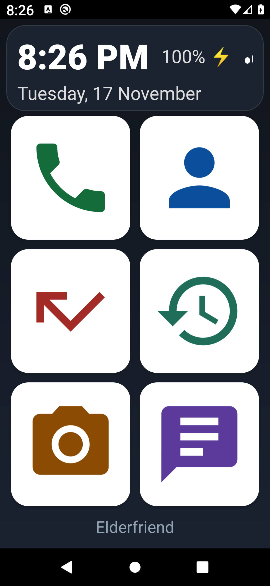
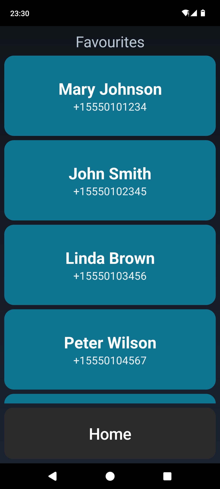
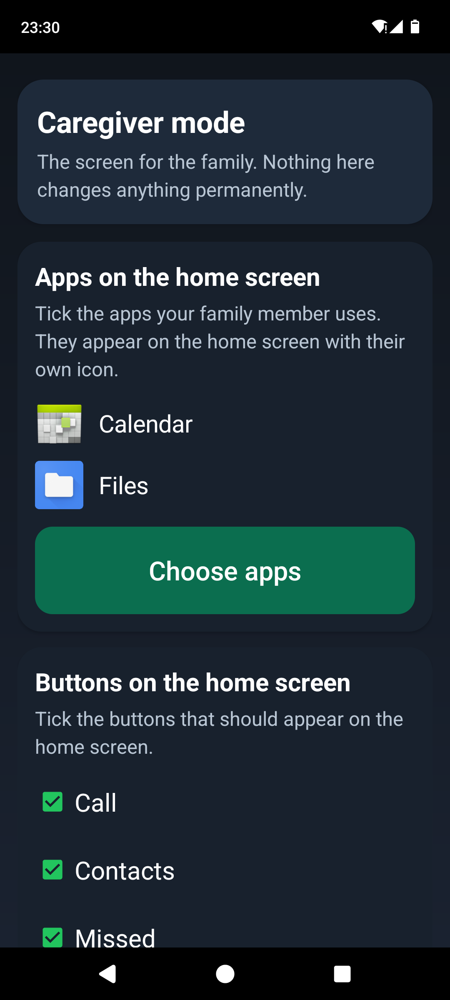

<p align="center">
  
</p>

<p align="center">
  <a href="https://github.com/ddddaaaattttoooo/elderfriend/releases/latest"></a>
  <a href="https://ko-fi.com/ddddaaaattttoooo"></a>
  <a href="https://discord.gg/gr4uwUyYTG"></a>
</p>

Elderfriend is a simple Android home screen for an older parent or
grandparent. One screen of big buttons. No swiping, no small text, no hidden
menus.

I first made it for my 87-year-old great-grandmother, but every grandparent
deserves a phone that is easy to use. Android 10+, free, MIT.

<p align="center">
  
  
  
</p>

<p align="center"><sub>Names and numbers in the screenshots are made up.</sub></p>

## What it does

- Big buttons for Call, Contacts, Missed, Recent, Camera and Messages.
- Favourites: one button per important person.
- SOS: texts the family your location, then calls them.
- "Mary called at 14:30 — call back" on the home screen.
- Warns when the battery is low.
- Asks "Call Mary?" before every call.
- You choose which other apps get a button (WhatsApp, Viber and others).
- English, Русский, ქართული.
- No internet permission. No account, no ads, no tracking.

## Install

1. Download the latest `Elderfriend-*.apk` from **Releases**.
2. Open it on the phone and allow the install.
3. Press **Home**, choose **Elderfriend**, tap **Always**.
4. Allow Contacts, Phone and Call log.

More detail: [docs/INSTALL.md](../docs/INSTALL.md). Prefer a script?
`tools/setup.sh Elderfriend.apk`. Prefer an AI helper? [PROMPT.md](../PROMPT.md).

## Caregiver mode

Hold the clock for 3 seconds. Here you pick buttons, apps, favourites and the
SOS number. A normal tap does nothing, so it can't be opened by accident.

## Permissions

| Permission | Why |
|---|---|
| Contacts | show names and numbers |
| Phone | make calls, show signal |
| Call log | Missed and Recent lists |
| Location, SMS | SOS only, asked only after an SOS number is set |

The app has **no internet permission**. It can't go online.

## Build

```bash
./gradlew assembleDebug
```

Needs JDK 17 and Android SDK 34. No libraries.

## License

[MIT](../LICENSE). Credits in [NOTICE](../NOTICE). Not affiliated with Google,
WhatsApp, Meta, Viber or Fossify.
