<p align="center">
  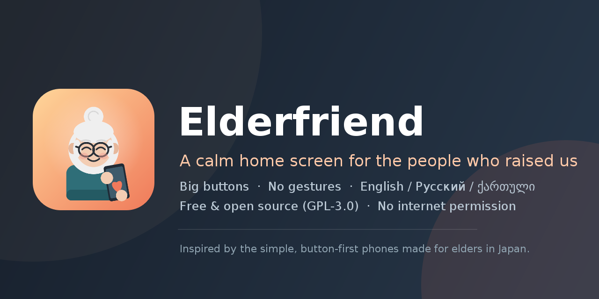
</p>

<p align="center">
  
  
  
  
</p>

<p align="center">
  <a href="https://github.com/ddddaaaattttoooo/elderfriend/releases/latest"></a>
</p>

<p align="center">
  <a href="https://ko-fi.com/ddddaaaattttoooo"></a>
  <a href="https://discord.gg/gr4uwUyYTG"></a>
</p>

Elderfriend is a very simple Android home screen for an older parent or
grandparent. One screen of big buttons, no swiping, no small text and no
hidden menus. It does not replace the phone, the contacts or the dialer — it
just puts the few things that matter in front of them in a way that is hard to
get lost in.

It was built for my 87-year-old great-grandmother, then cleaned up so other
families can use it too.

## Why it looks like this

It is inspired by the button-first phones made for older people in Japan
(らくらくホン style): a few clear choices, one action per screen, and a device
that never asks you to guess. Elderfriend brings that idea to an ordinary
Android phone:

- **Everything on one page** — big tiles with a name under every icon: Call,
  Contacts, Missed calls, Recent calls, Camera and Messages. Tiles shrink to
  fit instead of making anyone scroll.
- **Favourites** — the caregiver ticks the people who matter most; one big
  Favourites tile opens a screen with a button per person (name and number).
- **SOS** — once the caregiver sets an SOS number, a red SOS button appears
  next to the clock. After "Call for help?" it texts that number a map link to
  the phone's location, then calls it. Without a location it still texts and
  calls.
- **Your choice of apps** — in caregiver mode, pick the apps your family member
  actually uses (WhatsApp, Viber, Messenger, Facebook or anything else on the
  phone). They get a big tile with their own logo; nothing else clutters the
  screen. An app that gets uninstalled simply disappears from the home screen.
- **A red number on the Missed tile** when a call was missed, cleared the next
  time the missed-call list is opened.
- **"Who called" banner** — "Nino called at 14:30 — call back" right on the
  home screen. Several calls from one person say how many times; calls from
  different people open the missed-call list.
- **Low battery banner** — "Phone is at 14% — please charge it" below 20%; it
  disappears as soon as the charger is plugged in.
- **Lists, not puzzles** — contacts, missed calls and recent calls are
  full-width rows with a name and the number or time underneath.
- **A big "Call <name>?" confirmation** before any call is placed.
- **A camera screen** with three giant buttons: take a photo, turn on the
  flashlight, open the gallery.
- **No gestures at all** — every action is a single tap; the caregiver area
  opens by holding the clock for 3 seconds.
- **Three languages** — English, Русский, ქართული (follows the phone language).
- **Works offline** and asks for no account, no analytics, no cloud.

## Screenshots

**The names and phone numbers shown in the screenshots are fake.** They are
used only as examples, the `555` area code is unassigned, and none of them
belong to a real person.

<p align="center">
  
  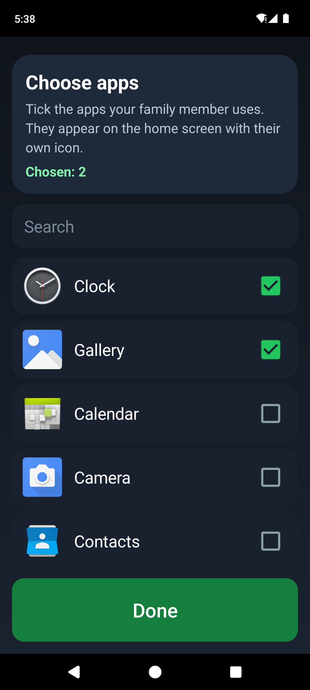
  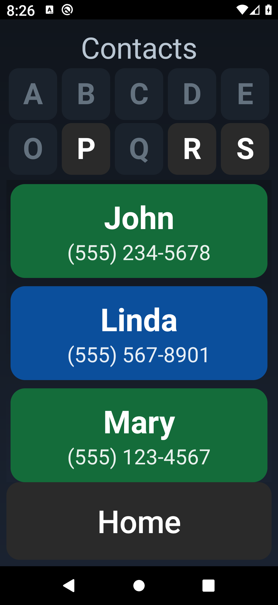
  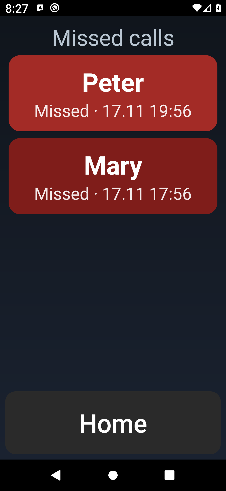
  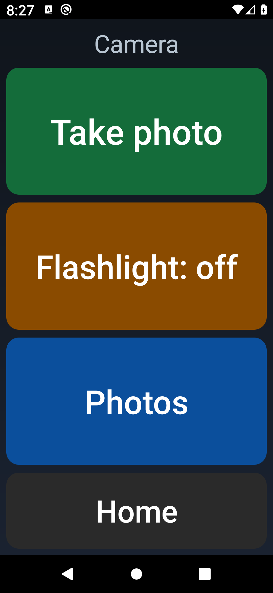
</p>

<p align="center"><sub>Screenshots use invented contact names and numbers. They are not real people.</sub></p>

### Setup, screen by screen

<p align="center">
  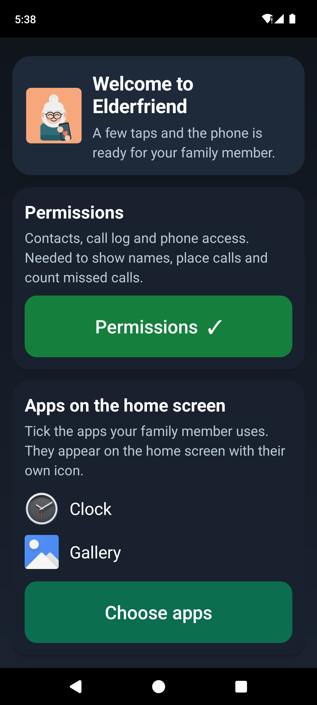
  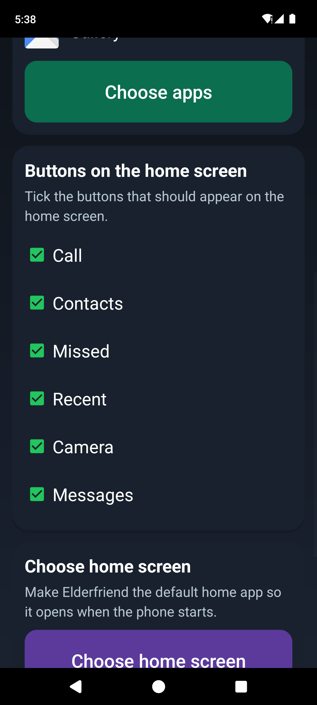
  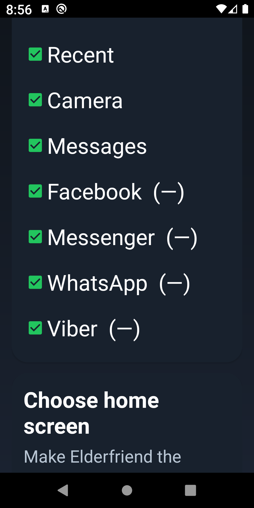
  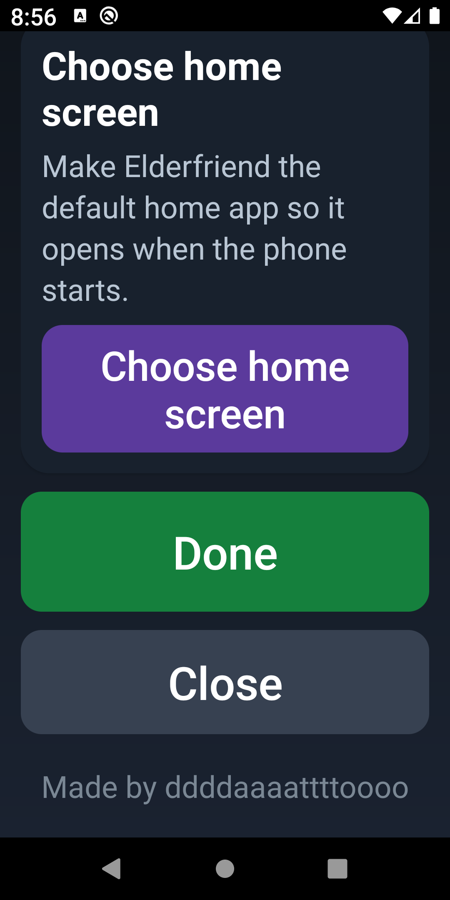
</p>

### Caregiver mode, screen by screen

<p align="center">
  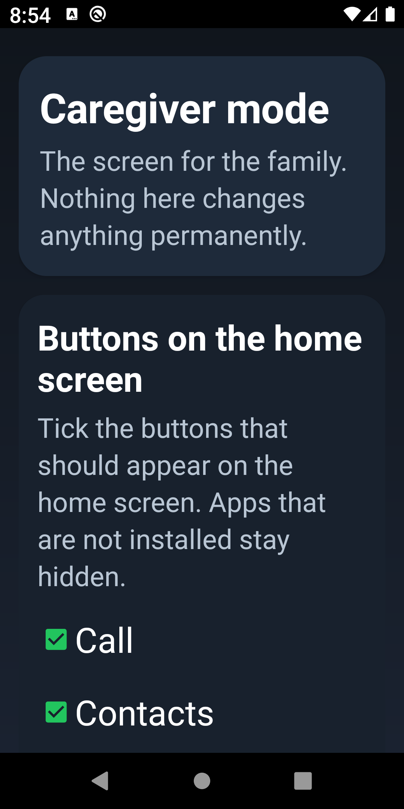
  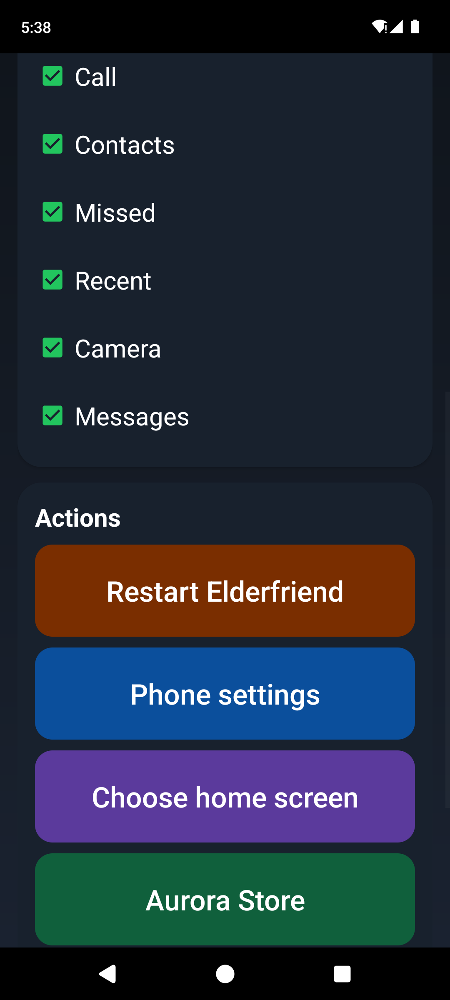
  
  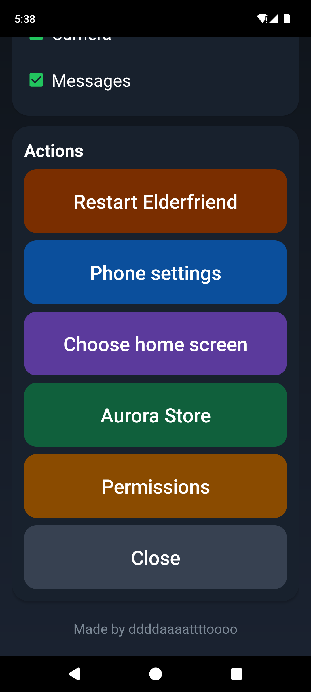
</p>

## First run

The first time it opens, Elderfriend shows a short setup screen made for the
family member who prepares the phone:

1. **Permissions** — contacts, call log and phone access, with one big button.
2. **Apps on the home screen** — tap **Choose apps** and tick the apps your
   family member uses. A search box helps on phones with many apps.
3. **Buttons on the home screen** — untick any built-in tile that is not needed.
4. **Choose home screen** — opens the Android screen where Elderfriend can be
   made the default home app.
5. **Done** — or **Close** to skip; nothing is mandatory.

The same options are always available later in caregiver mode, so setup does
not need to be repeated. If you want to see the wizard again, clear the app's
data in Android Settings.

## Caregiver mode

Hold the top bar with the clock and date for about three seconds. A normal tap
does nothing, so the phone owner cannot open this by accident.

Inside caretaker mode, all controls are large and nothing is destructive:

- **Buttons on the home screen** — check or uncheck any of the ten tiles.
  Missing apps show `(—)`.
- **Favourite contacts** — tick the people for the Favourites screen, with
  search. No limit.
- **SOS number** — the number SOS texts and calls; leave it empty to hide SOS.
  Setting it asks for location and SMS access.
- **Permissions** — asks for contacts, call log and phone access, or confirms
  they are already granted (the button turns green with a ✓).
- **Choose home screen** — the Android default-home picker.
- **Phone settings** — the real Android Settings, for Wi-Fi, sound, accounts.
- **Google Play** — opens the Play Store.
- **Aurora Store** — only shown when Aurora is installed.
- **Restart home** — reloads the home screen after changes.
- **Check for updates** — shows the installed version and opens the latest
  release page in the browser.
- **Close** — returns to the home screen.

Changes apply immediately: tick a tile, close, and it is on the home screen.

## Credits

Created and maintained by [@ddddaaaattttoooo](https://github.com/ddddaaaattttoooo),
originally for a great-grandmother who needed a phone that explains itself.
The launcher, logo and screenshots are original work; see [NOTICE](../NOTICE) for
third-party asset credits.

## Install

1. Download the latest `Elderfriend-*.apk` from this project's **Releases**
   page (GitHub: *Releases*, GitLab: *Deploy → Releases*).
2. Open it on the phone and allow installing from that source when Android
   asks.
3. Install, then press **Home**. Choose **Elderfriend** and tap **Always**.
4. Allow the three permissions it asks for: **Contacts**, **Phone** and
   **Call log**. They are only used to show the contact list, place calls and
   show missed/recent calls.

A step-by-step version with screenshots, ADB instructions and optional
extras (like replacing the swipe-to-answer dialer with
[Fossify Phone](https://fossify.org)) is in **[docs/INSTALL.md](../docs/INSTALL.md)**.

### Set it up with a coding assistant

Elderfriend installs on its own — helpers are optional. If you would rather
copy one prompt into Claude Code, Codex or Gemini CLI than type ADB commands,
**[PROMPT.md](../PROMPT.md)** has two independent tracks:

- **Just Elderfriend** — install, grant permissions, make it the home screen.
  Nothing else on the phone is touched.
- **Tuned setup** — the same, plus optional bigger interface/text and, only with
  your approval, disabling obvious vendor junk. Every change has an undo.

Prefer a script? `tools/setup.sh path/to/Elderfriend.apk` does the first track
(install, permissions, home app) and nothing more.

## Permissions

| Permission | Why |
|---|---|
| `READ_CONTACTS` | show the contact list with names and numbers |
| `CALL_PHONE` | place the call after the "Call <name>?" confirmation |
| `READ_CALL_LOG` | fill the Missed and Recent lists and the red badge |
| `READ_PHONE_STATE` | show signal bars and warn about a missing SIM |
| `ACCESS_FINE_LOCATION` | SOS only: the map link in the SOS text |
| `SEND_SMS` | SOS only: text the caregiver's SOS number |

Location and SMS are asked for only after the caregiver sets an SOS number.

There is **no `INTERNET` permission** in the app: it cannot go online. The only
thing it can ever send is the SOS text message, to the number the caregiver
set, and only after SOS is pressed and confirmed.

## Build it yourself

Requirements: JDK 17 and the Android SDK (platform 34, build-tools 34).

```bash
./gradlew assembleDebug       # debug APK in app/build/outputs/apk/debug/
./gradlew assembleRelease     # release APK (needs a signing config, see below)
```

For a signed release, put a `keystore.properties` next to `settings.gradle.kts`
(never commit it) or export the same values as environment variables:

```properties
KEYSTORE_FILE=/absolute/path/to/release.jks
KEYSTORE_PASSWORD=…
KEY_ALIAS=…
KEY_PASSWORD=…
```

Both GitHub Actions and GitLab CI build the debug APK on every push; see
`.github/workflows/build.yml` and `.gitlab-ci.yml`.

## Project layout

```
app/src/main/java/ge/elderfriend/launcher/   the whole launcher, no libraries
app/src/main/res/                            layouts, strings (en, ru, ka), icons
docs/                                        install guide and screenshots
assets/                                      logo and banner
```

The app is deliberately framework-only: no AndroidX, no Compose, no
dependencies, ~2 MB.

## Privacy

Elderfriend reads the phone book and the call log on the device, keeps tile
order in a local preference file, and does nothing else. Nothing is uploaded,
there is no network code and no third-party SDK.

## License

[MIT](../LICENSE). You can use, change, share and even sell it; just keep the
copyright notice. Third-party asset credits are in [NOTICE](../NOTICE); the tile
icons are derived from Material Icons (Apache-2.0) and the logo is original
artwork.

Elderfriend is an independent project. It is not affiliated with Google, Apple,
Fossify, WhatsApp, Meta or Viber; product names are used only to describe what
the tiles open.
